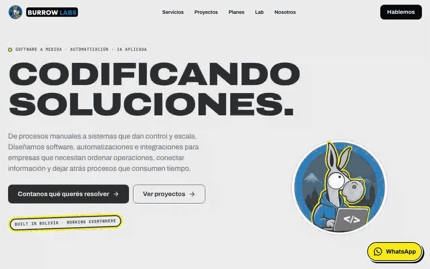
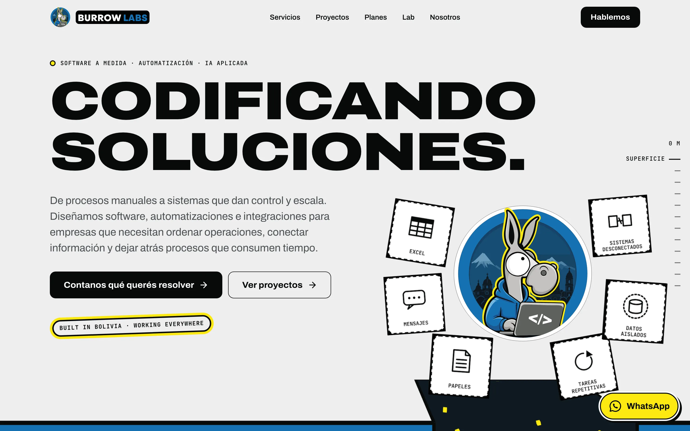
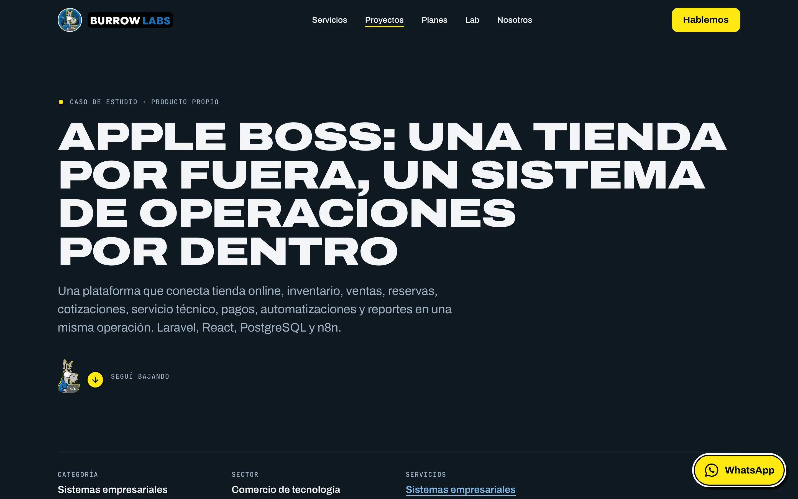
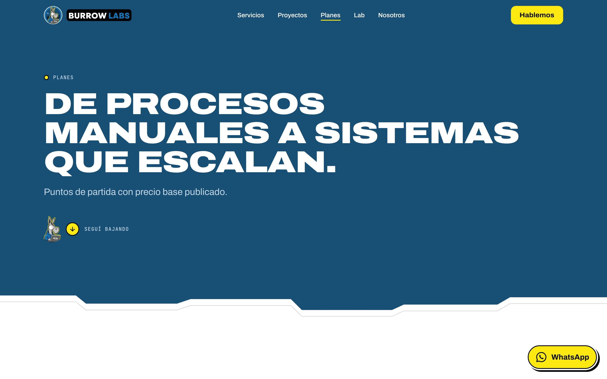
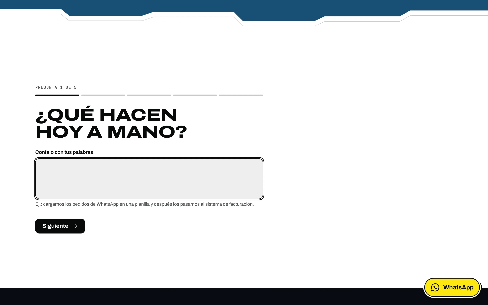
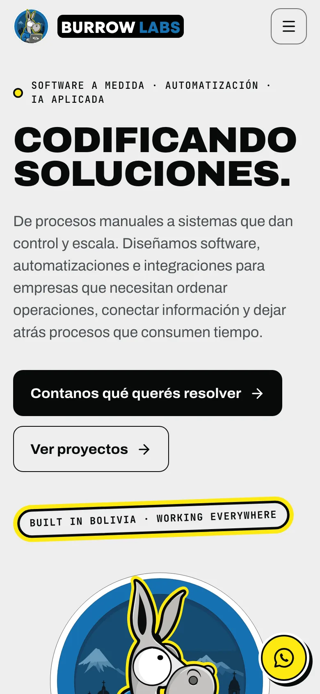
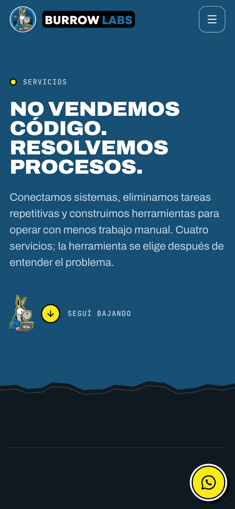
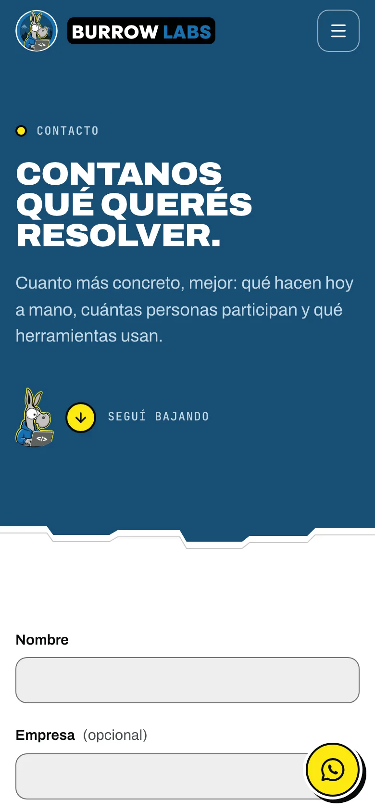
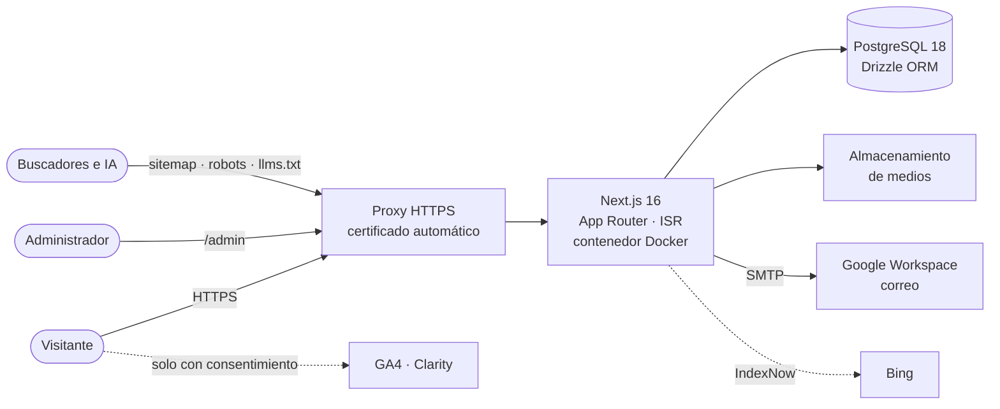

<div align="center">

<a href="https://burrowlabs.com.bo"></a>

<br>

<a href="https://burrowlabs.com.bo"></a>


<br><br>


<br><br>

**Sitio oficial y CMS de Burrow Labs**, software studio de Cochabamba, Bolivia.<br>
Sistemas a medida · Automatización · Integraciones · IA aplicada

[**Ver el sitio**](https://burrowlabs.com.bo) · [Casos de estudio](https://burrowlabs.com.bo/proyectos) · [Planes](https://burrowlabs.com.bo/planes) · [Diagnóstico express](https://burrowlabs.com.bo/diagnostico) · [Contacto](https://burrowlabs.com.bo/contacto)

</div>


## 🫏 Qué es esto

Este repositorio contiene **todo el sitio de Burrow Labs**: la web pública, las herramientas interactivas, el panel de administración y la infraestructura de pruebas con la que se publicó.

La dirección de arte se llama **«El descenso»**. El sitio se recorre como una madriguera que baja por estratos: la superficie es clara y, a medida que se baja, el terreno se vuelve más profundo y oscuro. El recorrido va de **madriguera → laboratorio → código → sistema → crecimiento**. Lo acompaña el burro de la marca, que anima el hero en 3D, guía el diagnóstico y protagoniza un juego escondido en la página 404.

El contenido es real: servicios, ocho casos de estudio, planes con precios base y textos legales aprobados. No hay clientes, testimonios ni métricas inventadas. Todo lo editable vive en la base de datos y se administra desde el panel.

<div align="center">


</div>

## 🎬 En acción

<div align="center">



</div>

<table>
  <tr>
    <td width="50%"></td>
    <td width="50%"></td>
  </tr>
  <tr>
    <td align="center"><sub><b>Inicio</b> · hero 3D con three.js y React Three Fiber</sub></td>
    <td align="center"><sub><b>Caso de estudio</b> · Apple Boss, producto propio</sub></td>
  </tr>
  <tr>
    <td width="50%"></td>
    <td width="50%"></td>
  </tr>
  <tr>
    <td align="center"><sub><b>Planes</b> · precios base publicados</sub></td>
    <td align="center"><sub><b>Diagnóstico express</b> · recomendación en minutos</sub></td>
  </tr>
</table>

<table>
  <tr>
    <td width="33%"></td>
    <td width="33%"></td>
    <td width="33%"></td>
  </tr>
  <tr>
    <td align="center"><sub>Inicio</sub></td>
    <td align="center"><sub>Servicios</sub></td>
    <td align="center"><sub>Contacto</sub></td>
  </tr>
</table>


## ✨ Qué incluye

<table>
<tr>
<td width="50%" valign="top">

### 🌐 Sitio público

- **Inicio** con hero 3D (tarjetas que caen y se acomodan), frases de marca y secciones administrables.
- **Servicios**: sistemas empresariales, automatización e integraciones, IA aplicada, web y e-commerce.
- **Proyectos**: 8 casos de estudio con ficha técnica, antes/después y esquemas SVG propios.
- **Planes** con precios base, **Nosotros**, **Clientes y sectores**, **Lab** (blog) y **FAQ**.
- **Contacto** con selector de país para WhatsApp y botón flotante de WhatsApp contextual.
- Textos legales completos: privacidad, términos y cookies.

</td>
<td width="50%" valign="top">

### 🧰 Herramientas

- **Diagnóstico express**: preguntas guiadas y una recomendación de servicio.
- **Calculadora de procesos manuales**: cuánto tiempo y dinero se pierde haciendo algo a mano, con resultado compartible por URL.
- **Burrow Runner**: un juego con el burro en la página 404, con récord en el navegador.

### 🛠️ Panel de administración

- CMS completo: servicios, proyectos, planes, FAQ, Lab, secciones del inicio, SEO por página, medios, textos legales y configuración.
- **Consultas** con estados, notas, exportación CSV y respuesta por correo.
- **Newsletter** con campañas, prueba antes de enviar y baja en un clic.
- Usuarios, bitácora de actividad y tablero con estadísticas propias.

</td>
</tr>
<tr>
<td valign="top">

### 🔎 SEO y búsqueda con IA

- Metadata única por página, canonical, Open Graph y Twitter Cards.
- Sitemap con `lastmod` real, `robots.txt`, `manifest` e iconos.
- JSON-LD: `Organization`, `WebSite`, `ProfessionalService`, `Service`, `Article` y `BreadcrumbList`.
- `llms.txt` para agentes de IA y avisos automáticos a Bing con **IndexNow**.

</td>
<td valign="top">

### 🔐 Privacidad y correo

- Estadísticas propias **sin cookies** (identificador seudónimo diario).
- Google Analytics 4 y Microsoft Clarity **solo después de aceptar** el aviso de cookies.
- Borrado automático de datos según los plazos publicados en la política de privacidad.
- Correo por SMTP (Google Workspace) con SPF, DKIM y DMARC; plantillas con la marca.

</td>
</tr>
</table>

## 🏗️ Arquitectura



| Capa | Cómo está resuelta |
|---|---|
| Renderizado | Server Components por defecto; `"use client"` solo donde hay interacción. Páginas prerenderizadas con revalidación cada 5 minutos y al guardar en el panel. |
| Datos | PostgreSQL con Drizzle (`casing: snake_case`), migraciones versionadas y seeds idempotentes con el contenido real. |
| Mutaciones | Server Actions con validación Zod, verificación de sesión y revalidación por etiquetas. |
| Motion | Motion para microinteracciones, GSAP ScrollTrigger en hero y proceso, three.js solo en el hero; todo respeta `prefers-reduced-motion`. |
| Despliegue | Imagen Docker que migra, siembra y arranca; detrás de un proxy con HTTPS. |

## ✅ Calidad

| Qué | Resultado |
|---|---|
| Pruebas unitarias y de integración (Vitest) | **159** en verde |
| Pruebas de punta a punta (Playwright) | **62** en verde, incluida accesibilidad con axe (WCAG 2.1 A y AA) |
| Lighthouse en producción (escritorio) | Rendimiento **99** · Accesibilidad **100** · Buenas prácticas **100** · SEO **100** |
| Lighthouse en producción (móvil) | Rendimiento **94–95** · CLS **0** · Accesibilidad, buenas prácticas y SEO **100** |
| Diseño adaptable | Sin desbordes horizontales de 320 a 1920 px |
| Seguridad | CSP estricta, HSTS, cookie de sesión `__Host-`, límites de frecuencia, contraseñas con scrypt y sin cabecera `X-Powered-By` |

<sub>Mediciones del 4 de octubre de 2026, día de la publicación. Lighthouse con la caché caliente.</sub>


## 🚀 Empezar

**Requisitos:** Node.js 26, pnpm 11 y PostgreSQL 17 o 18 (producción usa la 18).

```bash
pnpm install
cp .env.example .env.local   # completar DATABASE_URL, AUTH_SECRET, ADMIN_EMAIL y ADMIN_PASSWORD
createdb burrow_labs && createdb burrow_labs_test
pnpm db:migrate && DB_TARGET=test pnpm db:migrate
pnpm db:seed                 # crea el administrador y el contenido inicial (idempotente)
pnpm dev                     # http://localhost:3000 · panel en /admin
```

Para fijar o cambiar la contraseña de un administrador (la pide sin mostrarla):

```bash
pnpm admin:password admin@ejemplo.com
```

### Variables de entorno

Todas están documentadas, con valores de ejemplo, en [`.env.example`](.env.example). Ningún secreto vive en el repositorio.

| Grupo | Variables |
|---|---|
| Base de datos | `DATABASE_URL`, `TEST_DATABASE_URL` |
| Sitio y sesión | `NEXT_PUBLIC_SITE_URL`, `AUTH_SECRET`, `ADMIN_EMAIL`, `ADMIN_PASSWORD` (solo el primer arranque) |
| Medios | `STORAGE_DRIVER` (`local` o `s3`) y `S3_*` |
| Correo | `EMAIL_DRIVER` (`log`, `smtp`, `resend`, `brevo`), `EMAIL_FROM`, `EMAIL_FROM_NEWSLETTER`, `SMTP_*`, `EMAIL_API_KEY` |
| Medición y buscadores | `NEXT_PUBLIC_GA_ID`, `NEXT_PUBLIC_CLARITY_ID`, `NEXT_PUBLIC_GSC_VERIFICATION`, `INDEXNOW_KEY` |

### Comandos

| Comando | Para qué |
|---|---|
| `pnpm dev` | Servidor de desarrollo |
| `pnpm build` · `pnpm start` | Compilar y servir en modo producción |
| `pnpm lint` · `pnpm typecheck` | ESLint y TypeScript |
| `pnpm test` | Pruebas unitarias y de integración (Vitest) |
| `pnpm test:e2e` | Pruebas de punta a punta y accesibilidad (Playwright) |
| `pnpm check` | lint + typecheck + test + build |
| `pnpm db:generate` · `pnpm db:migrate` · `pnpm db:seed` | Migraciones y contenido inicial |
| `pnpm admin:password <email>` | Contraseña de un administrador |
| `pnpm brand:email` | Regenerar las imágenes de los correos |

## 🗂️ Estructura

```text
src/
├── app/
│   ├── (site)/        # sitio público: inicio, servicios, proyectos, planes, lab, legales…
│   ├── admin/         # panel de administración
│   ├── api/           # salud y estadísticas propias
│   ├── sitemap.ts · robots.ts · manifest.ts · llms.txt/
├── components/        # UI, inicio, proyectos, juego, herramientas y panel
├── db/                # esquema Drizzle, migraciones y seeds con el contenido real
└── lib/               # contenido, SEO, correo, sesión, analítica, retención, validación
e2e/                   # pruebas Playwright (sitio, panel, calidad y accesibilidad)
scripts/               # utilidades: contraseña del admin, compuerta de publicación…
public/brand/          # logo, mascota y recursos de correo oficiales
brand-src/             # fuentes de los assets de marca
docs/                  # diseño, arquitectura, CMS, SEO, seguridad y pruebas
```

## 🐳 Despliegue

El proyecto se publica como una imagen Docker. Al arrancar, el contenedor aplica las migraciones, siembra el contenido sin pisar lo existente, compila y sirve. Para un servidor propio alcanza con `docker-compose.yml` (sitio + PostgreSQL 17 + volumen de medios) detrás de un proxy con HTTPS:

```bash
cp .env.example .env   # completar las variables de producción
docker compose up -d --build
```

El kit de despliegue de producción, los procedimientos de rollback y los documentos de operación del servidor se mantienen fuera de este repositorio público.

## 🛡️ Seguridad y privacidad

- Sesión propia con cookie `HttpOnly`, `Secure` y prefijo `__Host-`, renovación deslizante y tope de 30 días.
- Límites de frecuencia por IP y por cuenta en ingreso, formularios y estadísticas.
- Formularios con consentimiento explícito, validación en servidor, trampas anti-bots y mensajes que no revelan datos.
- Ni los registros ni la bitácora guardan emails de visitantes ni contenido de formularios.
- Analítica de terceros solo con consentimiento; retiro del consentimiento desde la política de cookies.

Para reportar un problema de seguridad, escribí a **info@burrowlabs.com.bo**. El detalle técnico está en [`docs/SECURITY.md`](docs/SECURITY.md).

## 📚 Documentación

| Documento | Contenido |
|---|---|
| [PLAN](docs/PLAN.md) | Auditoría inicial, alcance y etapas |
| [DESIGN](docs/DESIGN.md) | Dirección de arte «El descenso», tokens y tipografía |
| [UI-KIT](docs/UI-KIT.md) | Componentes, variantes y contraste |
| [MOTION-3D](docs/MOTION-3D.md) | Motion, hero 3D, mascota y juego |
| [ARCHITECTURE](docs/ARCHITECTURE.md) | Carpetas, datos, caché y variables de entorno |
| [CMS](docs/CMS.md) | Qué se administra y cómo |
| [SEO](docs/SEO.md) · [SEO-CONTENT-ROADMAP](docs/SEO-CONTENT-ROADMAP.md) | SEO técnico, datos estructurados y plan de contenidos |
| [SECURITY](docs/SECURITY.md) | Controles de seguridad |
| [TESTING](docs/TESTING.md) | Estrategia de pruebas |
| [BRAND-ASSETS](docs/BRAND-ASSETS.md) | Logo, mascota y reglas de uso |

## 🏷️ Versiones

| Versión | Fecha | Notas |
|---|---|---|
| **1.0.0** · *V1 Final Production* | 4 de octubre de 2026 | Primera versión pública en producción en [burrowlabs.com.bo](https://burrowlabs.com.bo) |

## ©️ Derechos

© 2026 Burrow Labs. Todos los derechos reservados.

El código se publica para mostrar el trabajo del estudio. El nombre Burrow Labs, el logo, el burro y los textos del sitio son de Burrow Labs y no se pueden reutilizar sin autorización.

<br>

<div align="center">

<a href="https://burrowlabs.com.bo"></a>

<sub>Hecho con 🫏 en Cochabamba, Bolivia · <a href="https://burrowlabs.com.bo">burrowlabs.com.bo</a> · <a href="https://www.instagram.com/burrowlabsbo/">Instagram</a></sub>

</div>
